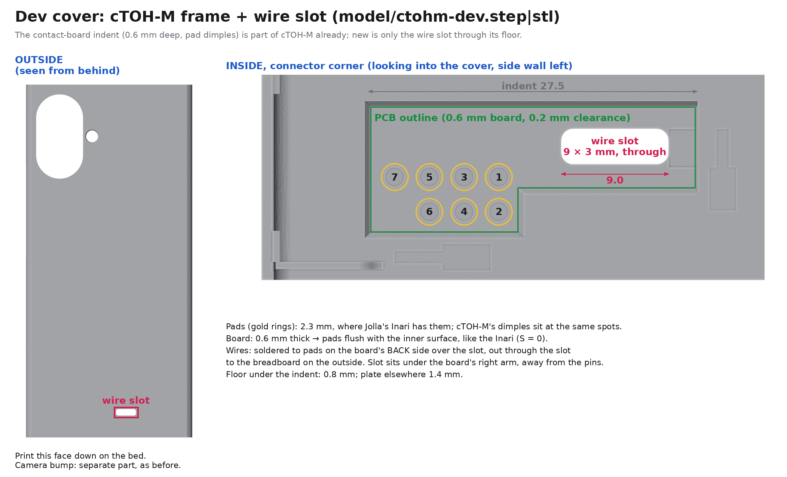
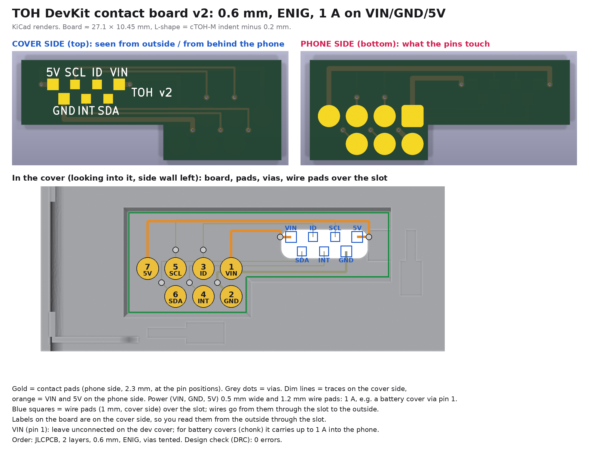
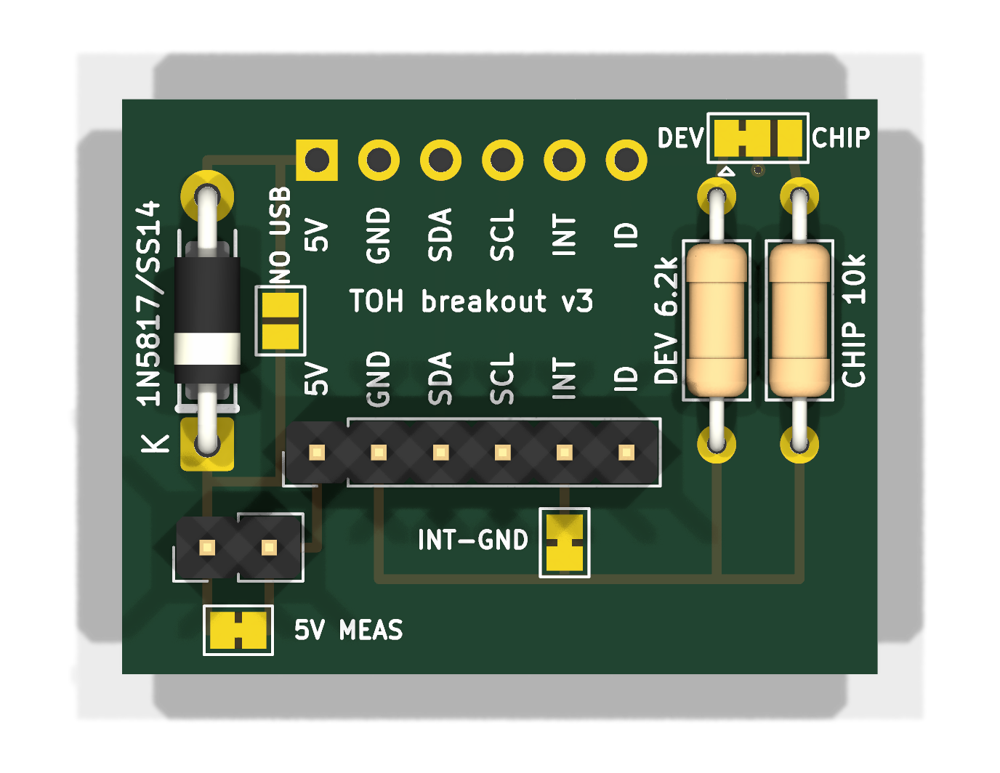
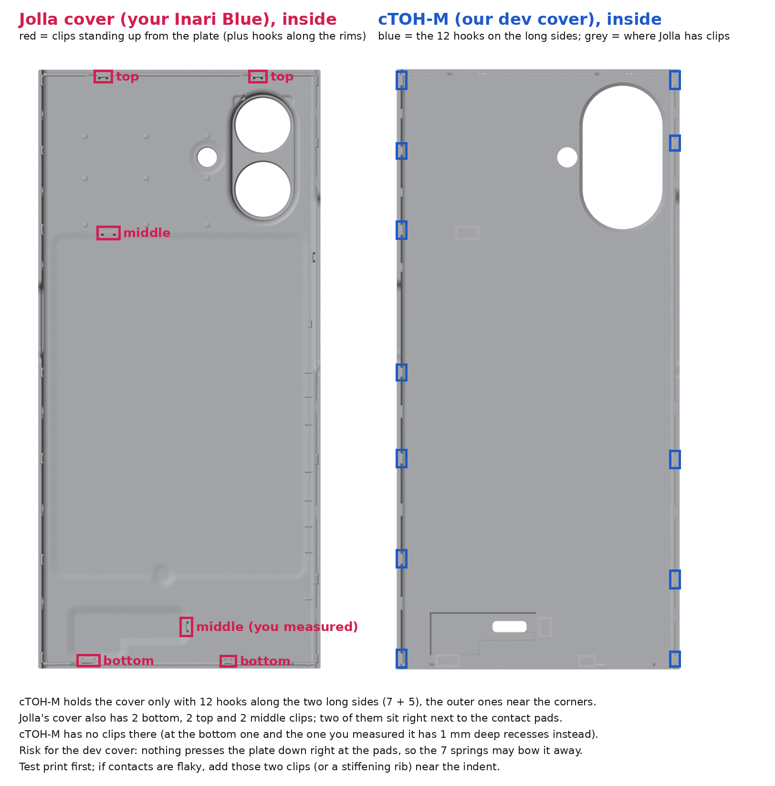
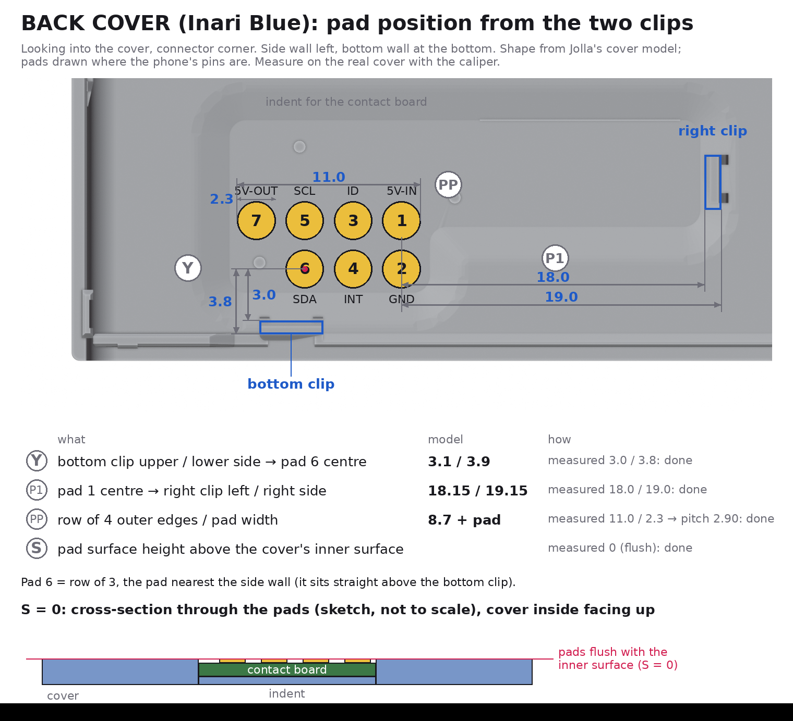

# TOH DevKit

Breadboard dev cover for The Other Half (TOH) connector of the Jolla Phone 2026.

> [!WARNING]
> **Work in progress, not tested yet.** Neither the PCBs nor the printed parts (STLs) have been built or tried on a phone. The designs are based on Jolla's models, the official spec and measurements, but expect mistakes. Use at your own risk, and check fit and voltages with a multimeter before putting anything on your phone.

A 3D-printed back cover ("The Other Half", TOH) for the Jolla Phone 2026 (`jp2601`) that brings the phone's 7 TOH contacts out to a mini breadboard on the back of the phone, for prototyping covers with a microcontroller (RP2040-Zero) and plug-in modules (IR, sub-GHz, LoRa, RFID, …).

**Status (2026-11):** cover model and both boards designed, boards ordered. Not yet printed or assembled, so nothing here is tested on hardware yet. Firmware (RP2040 I²C target) and the phone-side package are still to be written.

TOH spec (pins, ID resistors, memory chip format): https://docs.sailfishos.org/Develop/Hardware/JP2601-TOH/. Phone-side daemon: [symbiosis](https://github.com/sailfishos/symbiosis).



## Overview

```
 phone spring pins
        │
 [contact board]  in the cover's indent, gold pads toward the phone   (pcb/contact/)
        │  6 thin wires through a 9 × 3 mm slot in the cover
 [breakout board] on a mini breadboard stuck to the outside of the cover   (pcb/breakout/)
        │  6-pin header: 5V GND SDA SCL INT ID
 [RP2040-Zero + modules] on the breadboard
```

- **Cover** (`model/`): the community **cTOH-M** frame from Jolla's [toh-designs](https://github.com/sailfishos/toh-designs) repo, laid flat for printing, plus the wire slot. The frame already has an indent for a contact board; nothing else was changed
- **Contact board:** 0.6 mm thick, meant to sit flush in the indent. 7 gold pads should touch the phone's pins; vias carry the signals to wire pads on the other side, right above the slot
- **Breakout board:** takes the wires, sets the cover's ID, ties INT to GND, protects the phone from USB backfeed, and gives the breadboard a clean 6-pin header

## The phone's TOH connector (from the spec)

7 spring pins on the phone (lower right of the back, 2.90 mm pitch, rows of 4 and 3). The cover only needs flat pads.

| Pin | Signal | What it does | Rules |
|---|---|---|---|
| 1 | VIN | power *into* the phone (5–9 V, max 1 A; charges it) | **never connect on this cover** |
| 2 | GND | ground | |
| 3 | ID | resistor to GND tells the phone what kind of cover this is | never tie to 3.3 V/5 V |
| 4 | INT | pulled up to 1.8 V by the phone; the cover pulls it low = "attached" | never drive high |
| 5 | SCL | I²C clock, 3.3 V, 400 kHz | the phone has the pull-ups: none on the cover |
| 6 | SDA | I²C data, 3.3 V | same |
| 7 | 5V OUT | the cover's only power supply, 5 V, max 1 A, switched by the phone | |

What happens on attach, as I understand the spec and symbiosis (not verified on hardware yet): INT goes low → the phone switches 5 V on → reads the ID resistor through an ADC → with 6.2 kΩ (development ID) it uses vendor/product `0000/0000` and keeps 5 V on; with 10 kΩ it waits 100 ms and reads a memory chip at I²C 0x50. INT going high again counts as "cover removed".

## Contact board ([pcb/contact/](pcb/contact/))



- 2 layers, **0.6 mm**, **ENIG** (gold; tin or OSP would oxidise under the spring pins). 27.1 × 10.45 mm, L-shaped = the cTOH-M indent minus 0.2 mm on every side
- **Phone side:** 7 round pads, 2.3 mm (same size as on Jolla's Inari Blue cover), at the pin positions. **Pin 1 is the square pad.** Nothing else on this side but traces under solder mask and covered vias, so it stays flat
- **Cover side:** 7 square wire pads over the slot, labelled; readable from outside through the slot:
  ```
  top row:     5V   SCL   ID   VIN
  bottom row:    GND   INT   SDA
  ```
- **Power lines** (VIN, GND, 5V) are 0.5 mm wide with 1.2 mm wire pads: on paper about 1 A with only a few degrees of warming (calculated, not tested). The board is meant for every cover project, including battery covers that charge the phone through VIN. Signals are 0.2 mm
- **On this dev cover leave the VIN pad unconnected**

## Breakout board ([pcb/breakout/](pcb/breakout/))



Most options are **solder jumpers**: small pads next to each other on the board. "Bridged" ones are joined by a thin copper link: to open one, cut that link with a sharp knife and check with a multimeter that it's really open. To close a jumper, put a blob of solder across the pads (remove it with solder wick to open it again). All jumpers come in the state you need to get started, so you only touch them for a specific feature.

1.6 mm, HASL, 31 × 23.6 mm. Top row: 6 holes for the wires from the cover (`5V GND SDA SCL INT ID`, no VIN on purpose). Bottom row: 6-pin header into the breadboard, same order.

| Part | Does | As shipped / fitted | Change it when |
|---|---|---|---|
| **D1** 1N5817 (Schottky) | sits in the phone's 5 V line. I *think* it's needed: many small boards (the RP2040-Zero included) tie their 5 V pin directly to USB VBUS, and I couldn't find out whether the phone protects its 5 V output (pin 7) against power coming back in. With D1, USB should be able to stay plugged in while the cover is on the phone (flashing, serial debug). Costs ~0.3–0.45 V, so the breadboard gets ~4.6 V instead of 5 V; fine for the microcontroller, which makes its own 3.3 V | fitted, band (K) toward the header | keep it unless you know pin 7 is protected |
| **R1** 6.2 kΩ | ID resistor for **DEV mode** (development ID, no memory chip; the phone should detect the cover without any firmware). **Use while developing** | fitted | |
| **R2** 10 kΩ | ID resistor for **CHIP mode** (the microcontroller pretends to be the memory chip; see [ID-modes.md](ID-modes.md)). Only once that firmware works reliably | fitted | |
| **JP2** DEV / CHIP (3-pad solder jumper, top right) | connects ID to R1 or R2 | **DEV** (left + middle bridged) | to CHIP: cut the left bridge, check with a multimeter, bridge middle + right with solder. **Never bridge all three** (≈ 3.8 kΩ, not a valid ID: I expect the phone not to recognise it and switch 5 V off) |
| **JP1** INT-GND (solder jumper) | ties INT to GND, so the phone sees the cover as attached | **bridged** | only if the MCU should drive INT itself later (as far as I understand, symbiosis doesn't support cover interrupts yet; its README lists proper interrupt handling as missing). Then cut it and drive INT open-drain (pull low, never high) |
| **JP4** (solder jumper under "5V MEAS") + **J3** (2-pin header) | J3 is a measuring point in the 5 V line; JP4 bridges it so 5 V works without anything on J3 | JP4 **bridged**, J3 empty | to measure what the RP2040 and modules draw (limit 1 A): cut JP4 once, put a multimeter (current range) across J3. **From then on J3 needs a jumper cap or Dupont wire** for normal use, or re-bridge JP4 with solder |
| **JP3** "NO USB" (solder jumper next to D1) | bridges D1, so modules get the full 5 V instead of ~4.6 V (e.g. the RDM630 RFID reader is specified for 4.75–5.25 V) | **open** | bridge only while the microcontroller is **not** on USB (bridged, nothing stops USB power from flowing back into the phone); open it again before plugging USB in |

Header out (`J2`, left to right): `5V` (after D1) · `GND` · `SDA` · `SCL` · `INT` · `ID`.

## ID modes in short

| | DEV | CHIP |
|---|---|---|
| ID resistor (JP2) | 6.2 kΩ | 10 kΩ |
| Phone sees | vendor/product `0000/0000`, no name | whatever the RP2040's emulated memory chip says (planned `0000/0001`, name, product link) |
| Firmware needed for detection (expected, not tested) | no | **yes** (answer at 0x50 within 100 ms, payload with `PO` = true, otherwise I expect the phone to switch 5 V off again) |
| Use for | developing, flashing, anything unstable | the real-product path, the "install the companion app" link |

Firmware should always serve both 0x50 and its own address (planned 0x42); then switching modes is only the jumper. Details, checks and failure symptoms: **[ID-modes.md](ID-modes.md)**.

## Parts

- Printed: [model/ctohm-dev.stl](model/ctohm-dev.stl) (frame) + [model/ctohm-bump.stl](model/ctohm-bump.stl) (camera bump)
- Contact board: order with 0.6 mm, ENIG, vias tented (Gerbers: [pcb/contact/dev-toh-contact-gerbers.zip](pcb/contact/dev-toh-contact-gerbers.zip))
- Breakout board: order with defaults, 1.6 mm, HASL ([pcb/breakout/dev-toh-breakout-gerbers.zip](pcb/breakout/dev-toh-breakout-gerbers.zip))
- For the breakout: 1N5817, 6.2 kΩ and 10 kΩ (1/4 W, THT), 1×6 and 1×2 male header, jumper cap or female–female Dupont wire (only after cutting JP4)
- 6 thin wires (28 AWG silicone works), 170-hole mini breadboard (self-adhesive, fits on the back), RP2040-Zero, CA glue or thin double-sided tape for the contact board, multimeter

## Printing

- **Frame:** load as exported, outside face down. cTOH-M's authors recommend ASA with X/Y scaled to 100.3 % (needs an enclosed printer); PETG should work without. PLA is not advised (softens from the phone's heat, creeps under the clip tension). Check the side hooks for overhangs in the slicer
- **Bump:** open side down, roof up. Its built-in supports stand under the roof (extended down to the bed in this export, they used to start 0.16 mm above it)
- The indent floor sits at 0.8 mm and the inner surface at 1.4 mm, both multiples of 0.2 mm, so 0.2 mm layers give the 0.6 mm pocket depth exactly
- **After printing check:** the cover clips on firmly, the bump fits its opening, the indent is clean (no support remains) and ~0.6 mm deep. If the board is tight in the indent, sand its edge lightly

## Assembly

1. **Contact board** into the indent, gold pads toward the phone, square pad 1 next to the slot side. Glue it at the edges. It must sit flush; if pins don't make contact later, shim it from behind (a layer of tape)
2. **Breakout:** D1 (band toward the header), R1 6.2 kΩ, R2 10 kΩ, 6-pin header (pins down). Leave the jumpers as shipped (DEV, INT-GND bridged, JP4 bridged, NO USB open)
3. **Wires:** six wires (not VIN) from the contact board's wire pads, out through the slot, into the breakout's top holes by label. Keep them short and flat; stick the breadboard on the outside of the cover near the slot
4. **RP2040-Zero** on the breadboard: header `5V` → Zero `5V`, `GND` → `GND`, `SDA`/`SCL` → an I²C pair (e.g. GP0 = SDA, GP1 = SCL), optionally `INT`/`ID` to spare pins for monitoring only. No I²C pull-ups. 3.3 V modules: the Zero's 3V3 is weak, give radios their own 3.3 V regulator from `5V`

## First test (planned; no firmware needed)

Once it's built: cover on the phone, then over SSH (developer mode, no root):

```
cat /sys/class/yft_pogo_pin/*adc_value      # DEV: 600–799, CHIP: 800–999, nothing attached: ~1820
cat /sys/class/yft_pogo_pin/*int_state      # 0 = attached
cat /sys/class/yft_pogo_pin/*5v_out_state   # 1 = 5 V on (must stay 1)
gdbus call --system --dest org.sailfishos.tohd1 --object-path /org/sailfishos/tohd1 \
  --method org.freedesktop.DBus.ObjectManager.GetManagedObjects   # DEV: VendorId 0, ProductId 0
```

Then you should measure ~4.6 V between the header's `5V` and `GND`.

## If something goes wrong: check first

- **Contact trouble** (not detected, flaky I²C, wrong ADC value) or the cover lifting/rattling at the bottom: the cTOH-M frame holds only with 12 hooks on the two long sides, while Jolla's covers have two more clips right next to the contact pads (`renders/clips-compare.png`). The 7 springs may push the plate away from the pins. Test: press the cover down over the pads; if it then works, that's it. Quick fix: shim the contact board. Real fix: add those two clips or a stiffening rib in `scripts/make_dev_cover.py`

  

- **Breadboard gets no 5 V:** JP4 was cut for measuring and J3 has no jumper (or re-bridge JP4). Also check the cover is detected (`5v_out_state` = 1)
- **ADC reads ~400–600 / 5 V switches off right away:** all three JP2 pads bridged
- **CHIP mode doesn't work:** [ID-modes.md](ID-modes.md) → "If CHIP mode doesn't work". First go back to DEV to separate firmware problems from contact problems

## Phone side (to do)

- Accessing the TOH I²C bus needs root or a program allowed by a config file: symbiosis reads `*.yaml` from `/usr/share/tohd-1/tohs/<vid>/<pid>/` (DEV: `0000/0000/`, CHIP: `0000/0001/`). Planned config (one RPM installs it into both): `access: i2c-dev` for the polling program, `devices:` listing 0x42 and 0x50 (every address used must be listed), and a `user-unit` that starts the polling service on attach and stops it on detach. Format: symbiosis `doc/configuration.md`
- The program then borrows the bus over D-Bus (`org.sailfishos.tohd1`, `BorrowI2cDevAccess`) and polls the RP2040 (e.g. every 100–200 ms: status register first, data only when something is new)
- As far as I found, Sailfish has no way to prompt for a companion app on attach; in CHIP mode the product link at least ends up on D-Bus (`ProductWebsite`) for a helper to show

## Next steps

- Print, assemble, first test as above
- RP2040 firmware: I²C target at 0x42 (register protocol with an "enter bootloader" command reserved), later the memory-chip image at 0x50
- Phone package (RPM): config + polling service as above
- Modules: IR first, then CC1101 (433 MHz), RDM630 (125 kHz RFID; 5 V UART, needs a divider to 3.3 V), SX1262 LoRa (own 3.3 V regulator)

## Design notes (why it is like this)

- **No pogo pins, no screw:** the phone has the springs; Jolla's own covers use a small flat pad board held by the cover. Here it sits in the cTOH-M frame's indent
- **Positions:** taken from Jolla's cover model and the pin positions in the official back drawing, then checked by hand with a cheap caliper against my phone and my Inari Blue cover: pin tips ~0.9 mm, sticking out ~0.5 mm; the Inari's pads ~2.3 mm at 2.90 mm pitch, flush with its inner surface. Measured from the two clips next to the connector, the model and my Inari seemed to agree within ~0.15 mm (`renders/measure-cover-pads.png`). Honestly, I YOLO'd it: these are my own measurements and might be off; the first print and the real boards will show

  

- **0.6 mm board in a 0.6 mm indent** should give flush pads, as I measured on my Inari; the springs should then see about the same height as with Jolla's covers
- **Wires out the back through a slot** under the board's arm, so the solder blobs sit in the slot instead of lifting the board
- **Polling instead of INT:** as far as I understand, symbiosis only uses INT for attach/detach today
- **1N5817 kept** even though it costs ~0.4 V: I couldn't find out whether the phone protects pin 7, and the RP2040-Zero has no diode of its own. If someone knows pin 7 is protected, it could go

### Coordinates used in the scripts

`u` = mm from the phone's right edge, `v` = mm from its bottom edge, seen from behind. Pins: 1 (19.8, 8.45), 2 (19.8, 5.55), 3 (16.9, 8.45), 4 (16.9, 5.55), 5 (14.0, 8.45), 6 (14.0, 5.55), 7 (11.1, 8.45). Model frame (`model/`): X = −37 + u, Y = −78.8 + v, inside of the cover = +Z. KiCad top view = seen from behind the phone: X = 100 − u, Y = 100 − v.

## Files

- `model/ctohm-dev.step|stl`: cover frame (outside face down, ready for the slicer). `model/ctohm-bump.stl`: camera bump. `model/indent-outline.txt`: indent outline used for the PCB
- [pcb/contact/](pcb/contact/), [pcb/breakout/](pcb/breakout/): `make_board.py` generates the KiCad board (edit the script, not the board), `README.md` with details, `dev-toh-*-gerbers.zip` = what was ordered
- [ID-modes.md](ID-modes.md): DEV vs CHIP mode in detail
- `renders/`: `dev-cover.png` (model + slot), `pcb-check.png` (contact board in the cover), `breakout.png`, `clips-compare.png` (Jolla's clips vs cTOH-M's), `measure-cover-pads.png` (measurements on a real Inari Blue)
- `scripts/`: FreeCAD/Blender/Python scripts for the models and images

## Rebuilding

Tools: FreeCAD (`freecadcmd`), Blender, KiCad 10 (`kicad-cli`, Python `pcbnew`), Python 3 with Pillow.

- **Models:** clone [sailfishos/toh-designs](https://github.com/sailfishos/toh-designs), then from `scripts/`: `TOH_DESIGNS=/path/to/toh-designs freecadcmd -c "exec(open('make_dev_cover.py').read())"` (and `make_bump.py`)
- **Contact board:** needs the footprint `Jolla_JP2601_TOH_Contact_7P_P2.90mm_Pads` (`JOLLATOH_LIB=/path/to/JollaTOH.pretty python3 make_board.py`); the generated `.kicad_pcb` already embeds it, so opening and ordering need nothing extra. **Breakout:** `python3 make_board.py` (KiCad standard libraries only)
- **Check and export:** `kicad-cli pcb drc --severity-all -o drc.rpt <board>.kicad_pcb` (0 errors), then the Gerber/drill commands in each board's README
- **Images:** usage line at the top of each script

## License and credits

BSD-3-Clause, see [LICENSE](LICENSE): use, modify and redistribute freely (also commercially), keep the copyright notice, and don't use the authors' names to promote derived products.

- `model/` files are derived from Jolla's [toh-designs](https://github.com/sailfishos/toh-designs) (the cTOH-M community frame and camera bump, and measurements from `jolla/toh-3d-model.step`), © 2026 Jolla Mobile Ltd, also BSD-3-Clause. Thanks to the cTOH-M authors. Not affiliated with or endorsed by Jolla
- Everything else (PCBs, scripts, docs, renders): © 2026 Lorenz Graf and contributors

Contributions (pull requests) are accepted under the same BSD-3-Clause license.
